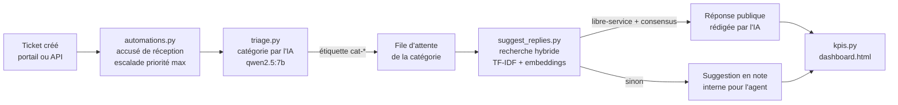

# Service desk IT automatisé : Jira Service Management + IA locale

Démo d'un support informatique N1/N2 où l'IA prend en charge les tâches répétitives : accusé de réception, tri et routage des tickets, réponse depuis une base de connaissances, suivi des indicateurs. Tout tourne **en local et gratuitement** : Jira Service Management Free, Python, et des modèles open source via [Ollama](https://ollama.com). Aucune donnée de ticket ne quitte le poste.

## Résultats

Sur 20 tickets réalistes (accès, messagerie, réseau, impression, matériel, logiciels) :

| Indicateur | Résultat |
|---|---|
| Tickets triés automatiquement par l'IA | **20/20**, catégorie correcte dans 100 % des cas |
| Bon article de base de connaissances trouvé | **20/20** |
| **Taux de résolution sans intervention** | **65 %** en mode hybride, mesuré hors ligne (60 % sur le Jira de démo, traité en TF-IDF seul) |
| Réponses automatiques erronées envoyées au client | **0** |

Le détail des mesures, avec 12 tickets reformulés en langage courant, est dans [RESULTATS-RECHERCHE.md](RESULTATS-RECHERCHE.md).

## Comment ça marche



| Script | Rôle |
|---|---|
| `seed_tickets.py` | Importe les 20 tickets de démo via l'API REST (sans doublon) |
| `setup_queues.py` | Crée les 7 files d'attente : « À trier » et une par catégorie |
| `automations.py` | Accusé de réception, assignation des priorités maximales, relance après 3 jours sans réponse du client |
| `triage.py` | Classe chaque ticket avec un LLM local (sortie JSON contrainte), avec repli par mots-clés si Ollama est indisponible, et une note interne qui justifie le choix |
| `suggest_replies.py` | Trouve l'article le plus proche (TF-IDF + embeddings), fait rédiger la réponse par l'IA à partir de l'article uniquement, puis décide entre réponse automatique et suggestion pour un agent |
| `kpis.py` | Calcule les indicateurs depuis Jira et génère `dashboard.html` |
| `pipeline.py` | Enchaîne toute la chaîne en boucle, pour une démo en direct |

### Garde-fous

- **Jamais de doublon** : chaque script pose une étiquette (`auto-ack`, `ia-triee`, `ia-repondu`…) *avant* d'agir, et ignore les tickets déjà traités. Tous les scripts peuvent être relancés sans risque.
- **Réponse automatique seulement si c'est sûr** : l'article doit être en libre-service (pas de droits à accorder, de matériel à livrer ni de panne à traiter), et les deux méthodes de recherche doivent désigner le même article.
- **Pas d'invention** : l'IA ne rédige qu'à partir des étapes de l'article, et chaque réponse cite sa source (`[Source : KB-11 …]`).
- **Traçabilité** : chaque décision de l'IA laisse une note interne avec le modèle, le score et la justification.
- **Mode dégradé** : sans Ollama, le tri passe par les mots-clés (90 % de précision) et les réponses citent l'article tel quel.
- **Données locales** : les modèles tournent sur le poste, rien n'est envoyé à un service d'IA externe.

## Installation

Prérequis : Python 3.11+, un site Jira Service Management (l'offre gratuite suffit) et [Ollama](https://ollama.com).

```powershell
git clone https://github.com/mcpolo78/jsm-demo; cd jsm-demo
python -m venv .venv
.venv\Scripts\python.exe -m pip install -r requirements.txt   # requests et python-dotenv uniquement
ollama pull qwen2.5:7b
ollama pull nomic-embed-text
copy .env.example .env   # puis remplir JIRA_URL, JIRA_EMAIL, JIRA_API_TOKEN, JIRA_PROJECT
```

Les dépendances sont volontairement réduites à `requests` et `python-dotenv` : le TF-IDF est écrit en Python pur, donc aucune bibliothèque compilée ne risque d'être bloquée par la politique de sécurité du poste (Contrôle intelligent des applications de Windows).

## Utilisation

```powershell
.venv\Scripts\python.exe seed_tickets.py            # tickets de démo
.venv\Scripts\python.exe setup_queues.py            # files d'attente
.venv\Scripts\python.exe pipeline.py --loop 30      # toute la chaîne, toutes les 30 s
.venv\Scripts\python.exe kpis.py --open             # tableau de bord
```

Chaque script accepte `--dry-run` pour afficher ce qu'il ferait sans rien modifier. `triage.py --eval` et `suggest_replies.py --eval` / `--compare` mesurent la qualité hors ligne, sans toucher à Jira.

## Base de connaissances

19 articles Markdown dans [`kb/`](kb/). Chacun indique sa catégorie, s'il est en libre-service, et des mots-clés. Pour ajouter un article, il suffit de créer un fichier : les embeddings sont recalculés automatiquement au prochain lancement.

## Pistes d'évolution

- Publier la base de connaissances dans Confluence et la relier au portail JSM.
- Déclencher la chaîne par webhook Jira plutôt que par interrogation périodique.
- Boucle de retour : quand un client répond « ça ne marche pas », rétrograder l'article et réévaluer le seuil.
- Remplacer les scripts d'automatisation par des règles Jira Automation natives quand le besoin le permet.
